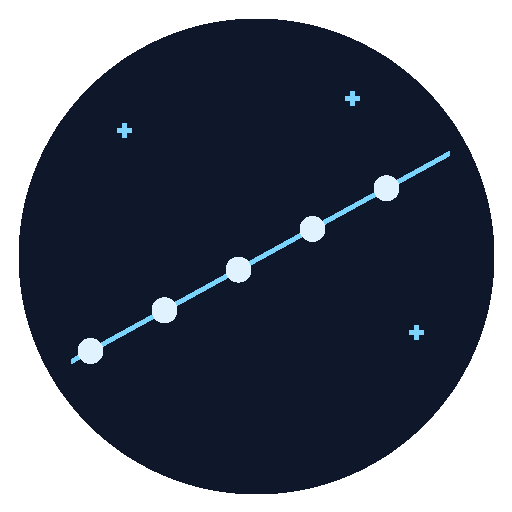

<p align="center">
  
</p>

# Starlink Train Watch

[](https://my.home-assistant.io/redirect/hacs_repository/?owner=JacosVerksted&repository=starlink-train-watch&category=integration)
[](https://www.home-assistant.io/)
[](https://github.com/JacosVerksted/starlink-train-watch/releases/latest)
[](https://github.com/JacosVerksted/starlink-train-watch/actions/workflows/validate.yml)
[](https://github.com/JacosVerksted/starlink-train-watch/blob/main/LICENSE)

Experimental Home Assistant integration for **potential recent Starlink train viewing opportunities**. This predicts satellites in the sky; it does not monitor Starlink internet equipment. Not affiliated with SpaceX, Starlink, CelesTrak, or Home Assistant.

## Status and limitations

**Tested with Home Assistant 2026.10.4.** Automated tests exercise real orbital calculations, synthetic launches, a complete Home Assistant config-entry lifecycle, entity transitions, and notification template eligibility/deduplication. **No real train sighting or end-to-end notification delivery has been validated.**

This is a geometric heuristic, not a brightness estimate or a validated compact-train model. Similar timing and tracks can describe a loose group that does not look like the familiar bright train. Satellite attitude, delayed catalogue updates, orbital manoeuvres, local obstructions and clouds can invalidate predictions. No candidates does not mean no satellite is visible. High-latitude summer darkness and satellite shadow can make opportunities rare.

## Installation with HACS

Requires Home Assistant **2026.10.4 or later** and an existing HACS installation. The version above is the tested baseline, not a claim of compatibility testing with every later release.

[Open repository in HACS](https://my.home-assistant.io/redirect/hacs_repository/?owner=JacosVerksted&repository=starlink-train-watch&category=integration)

1. Open HACS and search for **Starlink Train Watch**.
2. Download the integration, then restart Home Assistant.
3. Open Settings → Devices & services → Add integration → **Starlink Train Watch**.

Starlink Train Watch has been accepted into the [HACS catalogue](https://github.com/hacs/default/pull/13129). New listings can take time to appear while the catalogue refreshes. If it is not visible yet, use the repository link above or add `https://github.com/JacosVerksted/starlink-train-watch` under HACS → menu → Custom repositories, with category **Integration**.

For manual installation copy `custom_components/starlink_train_watch` into your HA configuration's `custom_components` directory, restart HA and add the integration as above. HACS installs the integration only; import the notification blueprint separately.

## How predictions work

- Uses HA's configured home latitude, longitude and elevation, with HA's timezone for local display. One home observer is supported.
- Downloads public CelesTrak last-30-days OMM orbital data and SATCAT launch dates over HTTPS. **Home coordinates stay local** and are not sent to CelesTrak, JPL, or tracking websites.
- Downloads JPL DE421 (~17 MB) once for local sunlight and twilight calculations. Internet access is needed for initial setup and data refreshes.
- Calculates a 48-hour horizon every 30 minutes. Orbital downloads are reused for six hours; cached-feed fallback is bounded to twelve hours.
- Defaults: launch age up to seven days, orbital epoch within three days, elevation at least 25°, Sun at or below −6°, and sunlit satellites.
- Requires at least three distinct satellites from the same launch, similar peak directions/elevations and a peak-time spread up to three minutes. Peak directions use spherical angular separation, including near-overhead passes.
- Integration options adjust the minimum satellite count, elevation, twilight, launch age and grouping time span. Weather is advisory; no automatic cloud-clearance guarantee is provided.

### Setup and Configure examples

The setup form includes examples beside each setting. After installation, change
these under Settings → Devices & services → Starlink Train Watch → **Configure**.
Saving options reloads the integration and recalculates predictions; existing
installations retain the previous defaults unless you change them.

The three counting/grouping rules are:

1. **Minimum predicted satellites** (`min_satellites`, default **3**): choose
   **3** to include smaller groups, **6** for at least six qualifying satellites,
   or **10** to prefer larger groups. Counts must be whole numbers of at least 3.
   Raising the minimum can remove all candidates; that does not mean the sky is empty.
2. **No fixed maximum satellite count**: this is automatic, not another numeric
   setting. The count comes from the available orbital records and qualifying
   passes, not a hard-coded SpaceX launch capacity. For example, a launch with
   **27** tracked satellites may produce a candidate with only **4** that meet
   your local filters. Larger future launch groups are not truncated to 27.
3. **Maximum train peak-time spread** (`max_span_seconds`, default **180**):
   **60** means all member peaks must fit within one minute; **180** permits
   three minutes; **300** permits five minutes. This is the span from the first
   to last member peak, **not** the allowed gap between every adjacent pair.
   Smaller values prefer tighter timing, but do not guarantee a compact visible
   line or that every member is above the elevation threshold simultaneously.

Example combinations (illustrative, not validated visibility presets):
- **More opportunities:** minimum **3**, spread **180 seconds**.
- **Tighter timing:** minimum **6**, spread **60 seconds**.
- **Larger groups:** minimum **10**, spread **180 seconds**.

Other filters also include examples in the form: elevation **25°** versus **40°**,
Sun altitude **−6°** versus **−12°**, and launch age **3** versus **7 days**.
All counts still require distinct satellites from the same recent launch,
similar tracks, sunlit satellites, and suitable local darkness and elevation.

### Entities

- **Next potential train:** timestamp with start/end, azimuth, launch group, launch date, satellite count and a `satellites` list. Each member includes its name, NORAD ID, international designator, orbital epoch, predicted start/peak/end, start/peak/end azimuth, maximum elevation, sunlight status and Sun elevation at its sampled peak, range and orbital altitude at peak. Times in attributes are timezone-aware; HA handles display. `unknown` means no candidate is currently predicted.
- **Prediction status:** readiness/cached/partial-data status and candidate counts. `unavailable` means update failure, not an empty sky.
- **Orbital data downloaded:** timestamp of cached orbital input.
- **Potential train visible:** predicted viewing-window binary sensor, not an optical detection.
- **Viewing opportunities:** read-only calendar for the current prediction horizon. Open an event to see member names, NORAD IDs, predicted local peak times, peak directions and elevations.

To inspect member details, open **Next potential train** and its attributes, or
use Developer tools → States. For example, a template can list predicted names:

```jinja2
{{ (state_attr('sensor.starlink_train_watch_next_potential_train', 'satellites') or [])
   | map(attribute='name') | join(', ') }}
```

These are **predicted geometric viewing windows**, not observed detections or
promises of naked-eye visibility. Details refer only to members of that candidate,
not every satellite in the launch. Observer coordinates are not included.

## Notifications

[Import viewing-reminder blueprint](https://my.home-assistant.io/redirect/blueprint_import/?blueprint_url=https%3A%2F%2Fgithub.com%2FJacosVerksted%2Fstarlink-train-watch%2Fblob%2Fmain%2Fblueprints%2Fautomation%2Fstarlink_train_watch%2Fnotify.yaml)

Alternatively copy `blueprints/automation/starlink_train_watch/notify.yaml` into the corresponding HA blueprints directory.

1. Create a dedicated **Text helper** with maximum length at least 100, and initialise its value to an empty string.
2. Create an automation from the blueprint, selecting the next-train sensor and that helper.
3. Optionally select an existing weather entity.
4. Select your notification action and use `{{ starlink_message }}` as its message.

Default reminder lead time is ten minutes, checked every minute. The helper remembers the last successfully notified candidate across restarts. Notification failures can be retried on a later check; external delivery cannot be guaranteed exactly once.

Notifications use your existing Home Assistant notification action. Configure and test your chosen delivery method separately in Home Assistant. Simulations test the actual message/condition templates, not external notification delivery.

## Troubleshooting

- No candidates: inspect prediction status and satellite/group counts. A recent launch alone does not guarantee suitable geometry or a recognisable train.
- Unavailable: check HA logs for `starlink_train_watch`, internet access, CelesTrak availability and the cached data timestamps.
- Missing launch metadata: public catalogues can lag; unknown launch dates are excluded rather than guessed.
- No reminder: verify the sensor has a future timestamp, the Text helper is available, the lead window is open, and test your notification action separately.

Report problems in [GitHub Issues](https://github.com/JacosVerksted/starlink-train-watch/issues). Include HA/integration versions and redacted error details. Do not post precise home coordinates, HA storage files or notification credentials.

## Development and tests

Use Python 3.14 and an isolated environment:

```sh
python3.14 -m venv .venv
. .venv/bin/activate
python -m pip install -r requirements-dev.txt
mkdir -p cache
curl --fail --location --output cache/de421.bsp https://ssd.jpl.nasa.gov/ftp/eph/planets/bsp/de421.bsp
TMPDIR=$PWD/cache pytest -q
ruff check custom_components tests --select E9,F63,F7,F82
```

Fixtures use public orbital records and a clearly synthetic group at a rounded test location (62°N, 6°E), not a user's home. Tests run in isolated HA configurations and never send household messages. To regenerate the synthetic scenario run `PYTHONPATH=. python tests/simulated_launch.py`; the report is written to ignored `simulation-results/`. The checked-in fixture allows ordinary tests without scenario generation. Ephemeris data is downloaded separately, not included in the integration release.

## Uninstall

Remove the integration through Settings → Devices & services, uninstall it in HACS, then restart HA. Remove the optional reminder automation, blueprint and dedicated helper if no longer needed. No unrelated HA configuration or registry restore is required.

## Licence and data attribution

Integration code and original icon: MIT. Orbital fixtures originate from [CelesTrak](https://celestrak.org/); ephemeris data originates from [NASA/JPL](https://ssd.jpl.nasa.gov/planets/eph_export.html). Third-party data and dependencies retain their own terms and are not relicensed by this repository.
